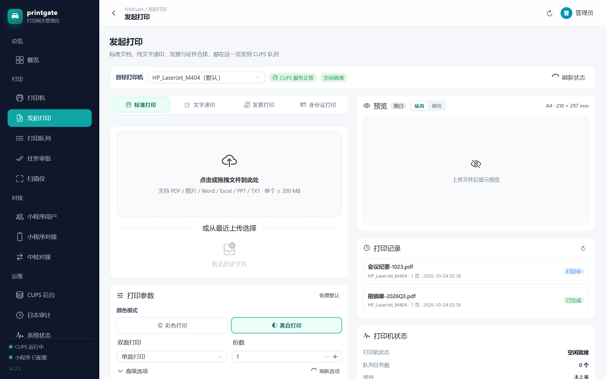
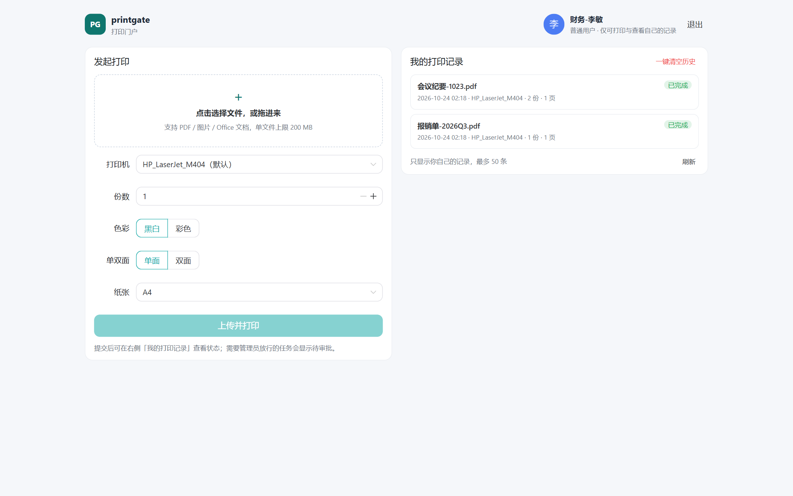
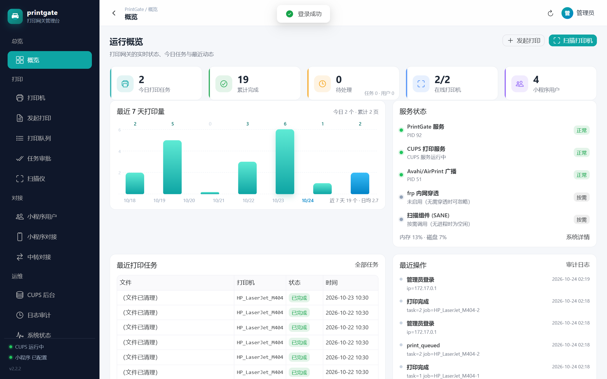
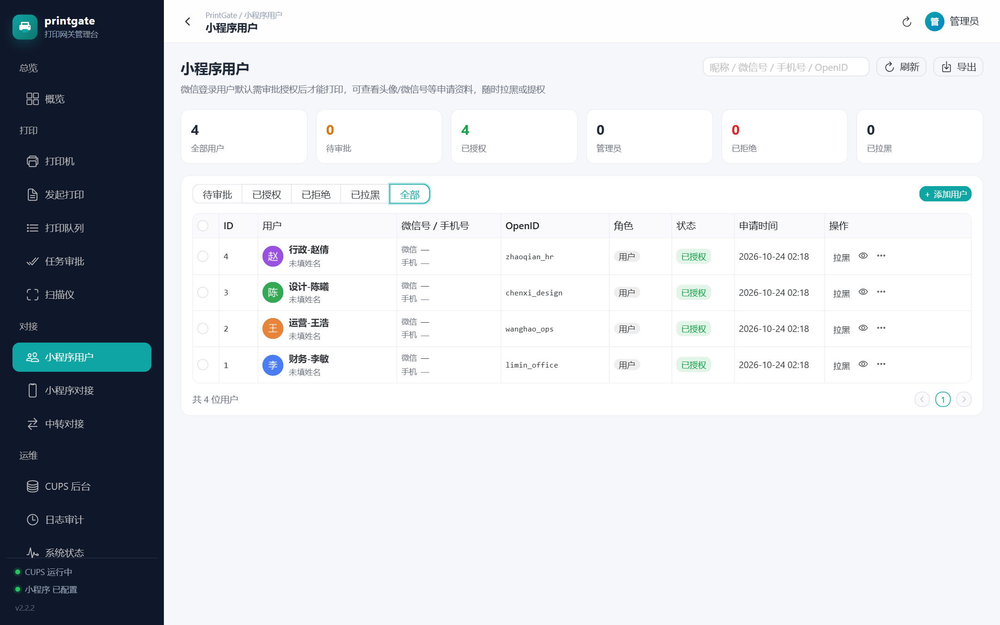
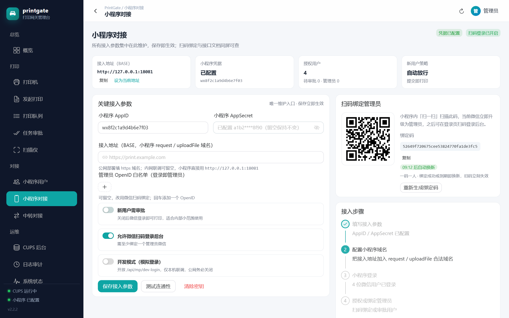
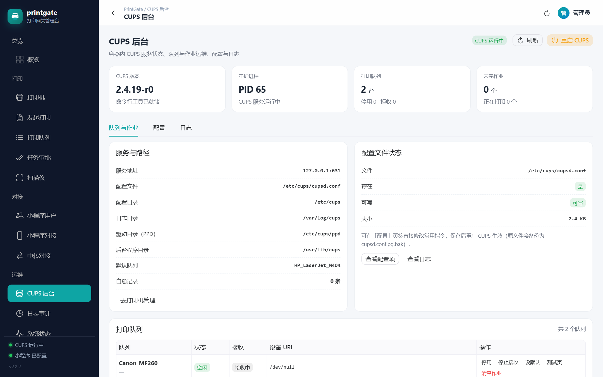
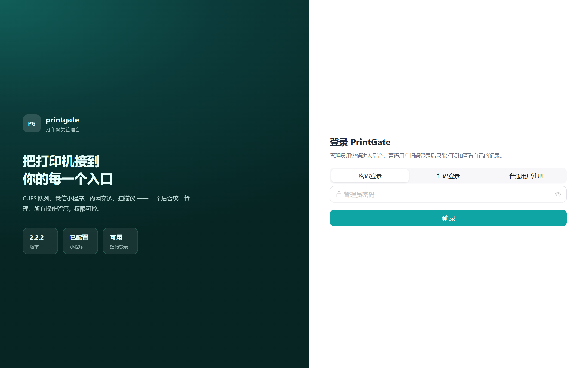

# 🖨️ PrintGate — CUPS 打印网关 + 微信小程序

<div align="center">

[](https://github.com/tomdfwe/printgate/releases)
[](https://hub.docker.com/r/tomdfwe/printgate)
[](https://hub.docker.com/r/tomdfwe/printgate)
[](https://github.com/tomdfwe/printgate/stargazers)
[](https://github.com/tomdfwe/printgate/issues)
[](https://github.com/tomdfwe/printgate/commits)
[](LICENSE)

[](https://nodejs.org)
[](https://vuejs.org)
[](https://vitejs.dev)
[](https://www.naiveui.com)
[](https://www.cups.org)
[](https://www.sqlite.org)
[](https://alpinelinux.org)

🏠 [GitHub](https://github.com/tomdfwe/printgate) • 🐳 [Docker Hub](https://hub.docker.com/r/tomdfwe/printgate) • 📦 [Docker 部署](docs/DOCKER-DEPLOY.md) • 📖 [部署指南](docs/DEPLOY-GUIDE.md) • 🧪 [测试报告](docs/TEST-REPORT.md) • 🔐 [安全评估](docs/SECURITY-BIND-CODE.md) • 🔍 [镜像隐私审计](docs/IMAGE-PRIVACY-AUDIT.md)

</div>

把一台 USB 打印机接上小主机，就能拥有：**浏览器上传即打印的管理台 + 微信扫码打印的小程序 + 全员可微信登录的打印门户**。
PrintGate 在容器里自带 CUPS，网页端、小程序端、AirPrint/IPP 三条入口共用同一批打印队列，所有操作留痕、权限可分层。

- 🖨️ **不用装驱动客户端**：iPad / iPhone / 手机微信 / 任意浏览器都能打印
- 📱 **微信即账号**：小程序扫码登录，管理员与普通用户自动分流，无需再记一套密码
- 🧾 **为票据和证件做过优化**：身份证自动矫正切割、发票合排、文字速印
- 🔐 **默认就安全**：scrypt 口令、JWT + 会话纪元、登录锁定、绑定码 10 分钟一次性、全链路审计

## 📸 界面预览

<div align="center">
<table>
  <tr>
    <td align="center"><br/><b>发起打印（标准 / 文字速印 / 发票合排 / 身份证）</b></td>
    <td align="center"><br/><b>普通用户门户（只能打印与会看自己的记录）</b></td>
  </tr>
  <tr>
    <td align="center"><br/><b>运行概览</b></td>
    <td align="center"><br/><b>小程序用户（头像 / 搜索 / 一键拉黑）</b></td>
  </tr>
  <tr>
    <td align="center"><br/><b>小程序对接（绑定码 / 扫码配置）</b></td>
    <td align="center"><br/><b>内置 CUPS 后台（队列 / 日志 / 配置）</b></td>
  </tr>
  <tr>
    <td align="center" colspan="2"><br/><b>登录页：管理员密码（可关）+ 微信扫码，按角色分流</b></td>
  </tr>
</table>
</div>

## ✨ 功能特性

### 打印能力

- **多格式**：PDF、图片（JPG/PNG/GIF/WEBP）、纯文本、Office（doc/docx/xls/xlsx/ppt/pptx，需 `WITH_OFFICE=1` 构建）
- **四种打印模式**：
  - **标准打印**：上传 → 预览（纸张/方向可视化）→ 份数/色彩/单双面/纸张/页码范围
  - **文字速印**：粘贴文本直接排版成 PDF，支持中文字体与字号行距
  - **发票合排**：多张发票/小票自动 2 合 1、4 合 1 排版到 A4，省纸
  - **身份证打印**：随手拍的歪斜证件**一键矫正识别切割**（`sharp` + 自研 Otsu/连通域/PCA 倾角算法，不依赖 OpenCV），正反两面拼一张 A4 实时预览，可单独调整旋转与缩放
- **实时预览**：改参数 250ms 防抖重排，所见即所打
- **任务全生命周期**：待审批 / 打印中 / 已完成 / 失败 / 取消 / 重试，状态对照 CUPS 队列每 8 秒校准，不谎报完成

### 扫描与虚拟打印机

- **扫描仪**：容器内置 `sane`，USB 与网络（eSCL/AirScan）扫描仪可直连，扫描件在网页预览与下载
- **虚拟打印机**：把 PrintGate 当作 9100 端口的打印接收器，老设备/ERP 直接往这里发任务，再转投物理队列
- **驱动管理**：网页里扫描已连接设备、安装厂商驱动（`.deb` / `.ppd`），装了什么、装到哪一步都有日志

### 微信小程序

- **扫码登录**：小程序扫网页二维码即可登录，**管理员进管理台、普通用户进打印门户**，两套会话互不越权
- **账号注册**：登录页「普通用户」Tab 用**用户名 + 密码**注册（3-32 位用户名、≥8 位含字母数字），注册后直接进入打印门户；
  不需要微信授权，适合不想装微信小程序或给外包/访客开号的场景
- **扫码绑定管理员**：后台生成绑定码（32 位随机 / 默认 10 分钟 / 一码一人），微信扫一下即升级为管理员
- **用户体系**：新用户默认待审批，后台可按头像/昵称/微信号/手机号检索、审批、拉黑、提权、删除；被拉黑会话立即失效
- **可控开户**：「允许普通用户自助注册」开关一关，登录页注册入口消失、新微信不再建号；改由管理员在
  「小程序用户 → 添加用户」里填 OpenID 直接开号（用户在小程序「我的资料」页可一键复制自己的 OpenID）
- **资料补全**：登录后用微信「头像昵称填写能力」一键带入头像与昵称（微信不允许静默读取，需用户点一次确认）

### 用户与权限

| 角色 | 网页入口 | 能做什么 |
| --- | --- | --- |
| 管理员 | `/` 管理台 | 全部功能：打印机、任务审批、用户管理、小程序对接、中转、CUPS、审计、系统设置 |
| 普通用户 | `/portal` 打印门户 | 上传打印、查看自己的打印记录、**一键清空自己的历史**；进不了任何管理接口 |

- 「隐藏普通用户详细设置」开关：打开后普通用户只能「选文件 → 选打印机 → 打印」，份数/色彩/单双面/纸张固定为默认
- 「允许管理员密码登录」开关：可与扫码登录二选一（不能同时关闭，服务端强校验，避免把自己锁在门外）

### 管理与安全

- **口令**：`scrypt(N=16384,r=8,p=1)` + 16 字节随机盐，旧版明文密码首次登录自动升级
- **会话**：JWT HS256 + 会话纪元（改密码后其他设备立即失效），有效期可配
- **防爆破**：登录失败按 IP 入库计数，5 次锁 15 分钟；敏感接口独立限流；全站 `/api` 每分钟 900 次
- **绑定码**：128 bit 随机 + `timingSafeEqual` + 一码一人 + TTL + 失败阈值自动换码（[评估报告](docs/SECURITY-BIND-CODE.md)）
- **审计**：登录、改密、上传、打印、审批、拉黑、设置变更、扫码、API Key 全部留痕，可检索导出
- **开放 API**：`pg_` 前缀 API Key（只存 SHA-256），可给第三方系统或脚本调用打印能力

### 部署与运维

- **单镜像自带 CUPS**：不用另起 CUPS 容器，`docker compose up -d` 即用
- **数据持久化**：SQLite（WAL）+ 自有 `printerstore` 对账，容器重启/断电后队列与配置自动恢复
- **内网穿透向导**：内置 frp 客户端与五步向导（TCP / wss 单端口 443 复用），小程序在公网可用
- **历史清理**：按天自动清理上传件、扫描件、CUPS 已完成作业、虚拟打印机落盘，也可手动分类清理

## 🛠️ 技术栈

**后端**

- Node.js 22 · Express 4 · better-sqlite3（WAL，预编译/本地编译均可）
- pdfkit（PDF 渲染）· sharp（图片处理与证件矫正）· qrcode（二维码）· jsonwebtoken（会话）· multer（上传）
- CUPS（Alpine 自带，IPP 2.0 直连 + `lpadmin`/`lpstat` 命令双通道）

**前端**

- Vue 3.5 · Vite 6 · Naive UI 2.40 · Vue Router 4（hash 模式）· axios
- 零构建依赖的静态产物，由 Express 直接托管（`server/public`）

**小程序**

- 原生小程序 + @vant/weapp 组件库；`code2session` 登录，JWT 会话，扫码绑定 / 扫码登录

**容器**

- 多阶段构建：Node 22 Alpine → 运行镜像内置 CUPS、sane、字体、可选 LibreOffice
- 默认 arm64 镜像约 594 MB；`WITH_OFFICE=1` 追加约 50 MB

## 🚀 快速开始

### 前置要求

- 一台 Linux 小主机 / NAS / 树莓派（**当前发布镜像仅 arm64**，x86 请自行构建，见下文）
- Docker 20+ 与 Docker Compose v2
- 打印机已通过 USB 接到主机（或局域网内有 IPP/AirPrint 打印机）

### 1. 创建 `docker-compose.yml`

```yaml
services:
  printgate:
    # 固定版本改 :2.2.2；latest 跟随最新正式版
    image: tomdfwe/printgate:latest
    container_name: printgate
    restart: unless-stopped
    ports:
      - "8080:8080"   # 管理台 + API + 小程序接口
      - "631:631"     # IPP / AirPrint
      # - "9100:9100" # 虚拟打印机接收器，不需要可删
    environment:
      TZ: Asia/Shanghai
      # 首次启动的默认值，之后都在「系统设置」里改
      # MAX_FILE_MB: "200"
      # APPROVE_NEW_USER: "true"
      # ENABLE_PASSWORD_LOGIN: "true"
    volumes:
      - ./data:/data        # 数据库 / 上传件 / 扫描件 / 头像 / frp 配置
      - ./cups:/etc/cups    # 打印队列（必须持久化，否则重启丢队列）
    # ── USB 打印机 / 扫描仪：放开下面两行 ──
    # devices:
    #   - /dev/bus/usb:/dev/bus/usb
```

> 💡 需要 AirPrint 广播与局域网自动发现时，改用 `network_mode: host` 并删掉 `ports` 段（mDNS 走组播，桥接模式发现不了设备）。

### 2. 启动

```bash
docker compose up -d
docker compose logs -f      # 首次启动会打印初始化提示
```

### 3. 首次初始化（网页 3 步）

1. 打开 `http://<主机IP>:8080` → 设置管理员密码（≥8 位，含字母和数字）
2. 「系统设置 → 打印与文件」选择默认打印机；没有队列就先去「打印机」页添加
3. 「小程序对接」页填 AppID / AppSecret / 接入地址，保存后点「测试连通性」

### 4. 绑定管理员微信

小程序 → 我的 → **扫码绑定**，扫后台「小程序对接」页右侧的绑定码，该微信立即成为管理员。
绑定码**一码一人、默认 10 分钟过期**，页面会倒计时并在用掉/到期后自动换新。

### 5. 给普通用户开通

把 `http://<主机IP>:8080` 发给同事，让他们打开登录页切到「普通用户注册」扫码进小程序建号即可。

新用户在小程序登录后默认「待审批」，到「小程序用户」页放行；或用「管理员 OpenID 白名单」自动放行。
之后普通用户在登录页扫码，会直接进入 `/portal` 打印门户。

### 源码运行（开发 / x86 自建）

```bash
# 后端（需本机有 CUPS；Windows 只能跑接口层）
cd server && npm install && PG_DATA_DIR=../_data PORT=8080 node src/index.js

# 前端（开发模式，热更新）
cd web && npm install && npm run dev     # 产出会被写到 server/public

# 构建镜像（x86 或 arm64）
docker buildx build --platform linux/amd64 -t printgate:dev --load .
docker buildx build --platform linux/arm64 -t printgate:dev --load .
```

## ⚙️ 配置说明

### 环境变量

| 变量 | 默认 | 说明 |
| --- | --- | --- |
| `TZ` | `Asia/Shanghai` | 容器时区，影响任务时间与定时清理 |
| `PORT` | `8080` | Web 与 API 端口 |
| `CUPS_SERVER` | `127.0.0.1:631` | 连接外部 CUPS 时改这里 |
| `DEFAULT_PRINTER` | 空 | 首次启动的默认队列 |
| `MAX_FILE_MB` / `MAX_COPIES` / `MAX_PAGES` | `200` / `10` / `200` | 单文件、份数、页数上限 |
| `APPROVE_NEW_USER` | `true` | 小程序新用户是否需审批（`false` 自动放行） |
| `APPROVE_EACH_JOB` | `false` | 是否逐单审批打印任务 |
| `ENABLE_QR_LOGIN` | `true` | 允许微信扫码登录 |
| `ENABLE_PASSWORD_LOGIN` | `true` | 允许管理员密码登录（与扫码不能同时关） |
| `HIDE_USER_ADVANCED` | `false` | 隐藏普通用户的详细打印设置 |
| `LOGIN_MAX_FAIL` / `LOGIN_LOCK_MIN` | `5` / `15` | 登录失败阈值与锁定时长 |
| `SESSION_HOURS` | `24` | 会话有效期 |
| `BIND_TOKEN_TTL_MIN` | `10` | 绑定码有效期（分钟） |
| `BIND_FAIL_ROTATE` | `50` | 30 分钟内失败多少次自动换绑定码 |
| `TRUST_PROXY` | 未设置 | 部署在反代之后设为 `true`（**公网直连不要开**） |
| `PG_DATA_DIR` | `/data` | 数据目录（数据库 / 上传 / 扫描 / 头像） |
| `RETENTION_DAYS` / `HISTORY_DAYS` | `30` / `30` | 文件与历史保留天数 |
| `WITH_OFFICE`（构建参数） | `0` | `1` 时镜像内置 LibreOffice，支持 Office 直打 |

> 以上都可以在「系统设置」页改，环境变量只决定**首次启动**的默认值。

### 端口

| 端口 | 用途 |
| --- | --- |
| `8080` | 管理台、REST API、小程序接口、扫码登录轮询 |
| `631` | CUPS：IPP 打印、CUPS 内置后台、AirPrint 发现 |
| `9100` | 虚拟打印机接收器（可选） |

### 数据持久化

| 路径 | 内容 |
| --- | --- |
| `/data/printgate.db` | SQLite：配置、用户、任务、文件索引、审计 |
| `/data/files` · `/data/scans` · `/data/avatars` | 上传件 / 扫描件 / 头像 |
| `/data/frp` | frpc 配置（开启穿透后生成） |
| `/etc/cups` | 打印队列与 CUPS 配置（**必须挂载**） |

### 目录结构

```
printgate/
├── server/src/
│   ├── index.js            # 入口：中间件、路由挂载、安全头
│   ├── security.js         # 口令/JWT/限流/绑定码/票据
│   ├── routes/             # auth mp print printers users settings system wechat relay cups apikeys
│   ├── cups.js             # lpstat/lpadmin/IPP 封装
│   ├── render.js idcard.js # PDF 排版与证件矫正
│   ├── printerstore.js     # 队列配置自有存储 + 对账重建
│   └── db.js migrate.js    # SQLite 与旧数据迁移
├── web/src/                # Vue3 管理台（views / layouts / store / router）
├── miniprogram/            # 原生小程序（pages + packageAdmin 分包）
├── docker/                 # entrypoint.sh、cupsd.conf
├── tools/                  # 20+ 套接口/UI 回归脚本
└── docs/                   # 部署指南、测试报告、安全评估、截图
```

## 📖 使用指南

### 管理员

- **发起打印**：选文件 → 选队列 → 调参数 → 预览 → 打印；「任务审批」页可逐单放行/拒绝
- **打印机**：增删队列、暂停/恢复、设默认、清队列、装驱动、看墨盒与纸张
- **小程序用户**：按状态筛选与搜索，点开看申请资料，一键拉黑/解除/通过/提权
- **审计日志**：按动作与人筛选，导出 CSV

### 普通用户

1. 网页登录页扫码（或用管理员给的小程序链接）→ 进入 `/portal`
2. 上传文件 → 选打印机 → 打印
3. 「我的打印记录」看状态；「一键清空历史」只清**已结束**的自己任务与文件，进行中的不受影响

### 开放 API

```bash
# 用 API Key 提交打印（Key 在「API Key」页生成，只存 SHA-256）
curl -X POST http://<主机IP>:8080/api/print/upload \
  -H "X-API-Key: pg_xxxxxxxxxxxxxxxx" \
  -F "file=@report.pdf" \
  -F "printer=HP_LaserJet_M404" \
  -F 'options={"copies":1,"color":"mono","sides":"one-sided","media":"A4"}'
```

## 🔧 进阶配置

### 反向代理与 HTTPS

小程序只接受 **https + 443**，公网使用时用 nginx 终结 TLS 再回源 `127.0.0.1:8080`：

```nginx
location /api/ { proxy_pass http://127.0.0.1:8080; proxy_set_header Host $host; }
```

- 容器需加 `-e TRUST_PROXY=true`，否则审计与限流会把所有人记成代理 IP
- 代理**必须与本服务同机或同内网**：直连公网时会忽略 `X-Forwarded-For`（防伪造绕过锁定）
- 上传大文件请调 `client_max_body_size`

### 内网穿透（frp）

「中转对接」页五步向导会生成 `frps.toml` 与 nginx 片段，支持 `tcp` 与 `wss`（单端口 443 复用）两种模式；
配置写好后点「运行自检」，本机服务、打印机、frpc 语法、服务端连通、公网回连全绿再启用。

### 备份与升级

```bash
# 备份（数据库 + 队列 + 文件）
tar czf printgate-$(date +%F).tar.gz ./data ./cups

# 升级
docker compose pull && docker compose up -d
```

数据卷 `/data` 与 `/etc/cups` 不变，升级不丢配置；旧版本数据库首次启动会自动迁移。

## ❓ 常见问题

### 忘记管理员密码？

在「系统设置 → 安全」里若还开着扫码登录，可用管理员微信扫码进入后改密码；
两种方式都进不去时，只能停容器、备份并删除 `./data/printgate.db` 后重新初始化（**会丢失配置与历史**）。

### Web 端看不到打印机？

1. 进「CUPS 后台」确认 `lpstat -p` 有队列、状态 `idle`
2. 没有队列先「打印机 → 添加」，或用「驱动管理」扫描设备后一键添加
3. USB 打印机需要挂载 `/dev/bus/usb` 并在宿主侧未被别的服务占用

### AirPrint / 局域网发现不到打印机？

mDNS 依赖组播，桥接网络下发现不了。改用 `network_mode: host`，并确认宿主未屏蔽 5353/UDP。

### 关掉自助注册后怎么给同事开号？

管理员在「小程序用户 → ＋添加用户」里填写对方的 OpenID（对方在小程序「我的 → 我的资料」页点「复制 OpenID」发给你），
选好角色与状态即可；对方用微信登录时会认这条记录，不会重复建号。关闭注册时这条通道仍然可用。

### 普通用户能用哪些打印功能？

审批通过后，门户右上角会出现「高级打印」入口，进入**打印工作台**——和管理台「发起打印」是同一套能力：
标准文档（含实时预览、份数/色彩/单双面/纸张/方向/页码范围/缩放/镜像/水印）、文字速印、发票合排、身份证矫正与合排。
区别只有两点：**只能看到和操作自己的文件与任务**，以及**没有任何后台设置入口**（系统设置/用户管理/审计/打印机增删全部 401/403，
打印机只能读列表用于选择）。管理员若开了「隐藏普通用户详细设置」，工作台顶部会提示按默认参数提交。

### 注册完为什么不能打印？

默认「小程序新用户需审批」是开着的：新注册账号为**待审批**状态，门户能登录、能看自己的记录，但上传与打印会被拒绝（后端返回 `403 NOT_APPROVED`）。
管理员到「小程序用户 → 待审批」点『通过』后，门户 15 秒内自动解锁，无需重新登录。
审批通过只是获得打印权限，**任何后台设置页依然进不去**（系统设置、用户管理、审计、打印机管理全部 401/403）。

### 注册完为什么不能打印？

默认「小程序新用户需审批」是开着的：新注册账号为**待审批**状态，门户能登录、能看自己的记录，但上传与打印会被拒绝（后端返回 `403 NOT_APPROVED`）。
管理员到「小程序用户 → 待审批」点『通过』后，门户 15 秒内自动解锁，无需重新登录。
审批通过只是获得打印权限，**任何后台设置页依然进不去**（系统设置、用户管理、审计、打印机管理全部 401/403）。

### 普通用户在哪里注册？

网页登录页第三个 Tab「普通用户」→ 点「立即注册」，填用户名、密码（可选昵称）即可。用户名 3-32 位小写字母/数字，
密码至少 8 位且含字母和数字。默认需要管理员审批，通过后即可打印；管理员关掉「允许普通用户自助注册」后该入口消失。
也可以继续走微信：小程序登录后由管理员放行，再用「扫码登录」进门户。

### 关掉「允许管理员密码登录」后，登录页还是显示密码框？

升级到 2.2.2 即可：旧版登录页缓存了首次加载的引导信息，退出到登录页时不会重取。
2.2.2 起进入登录页会强制刷新 `/api/public/bootstrap`，并保留了「密码登录已关闭」的服务端兜底（直接调接口仍是 403）。

### 普通用户扫码后进不去，只回到登录页？

- 该微信在后台是「待审批」或「已被拉黑」：前者先放行，后者解除后重试
- 令牌过期（默认 24 小时）：重新扫码即可
- 管理员关掉了扫码登录：`ENABLE_QR_LOGIN` / 设置页开关

### 绑定码提示「不正确或已失效」？

绑定码**一码一人 + 10 分钟 TTL**，被用过或超时都会立即换新。以后台页面当前显示的码为准；
页面上的倒计时归零后会自动刷新出新码。

### Office 文档上传报「需要先转 PDF」？

默认镜像未内置 LibreOffice（体积考虑）。用 `--build-arg WITH_OFFICE=1` 重新构建即可直打 docx/xlsx/pptx。

### 端口 631 被占用 / CUPS 起不来？

宿主如果已经装了 CUPS，会抢占 631。两种解法：停掉宿主 CUPS，或用
`network_mode: host` + 在设置里改 `CUPS_SERVER` 指向宿主已有的 CUPS（本容器内 CUPS 保持关闭）。

### 反向代理后所有人都被锁？/ 审计里全是同一个 IP？

没加 `TRUST_PROXY=true`，服务只能看到代理的地址。加上后重启即可；同时确认反代用
`proxy_set_header X-Forwarded-For $proxy_add_x_forwarded_for;`，把真实客户端地址追加到尾部。

### 只有 arm64 镜像，x86 服务器怎么用？

当前发布镜像为 `linux/arm64`。x86 请自行构建：`docker buildx build --platform linux/amd64 -t printgate:x86 --load .`
（仓库内的 GitHub Actions 已配置 amd64 + arm64 双架构构建，打 tag 时会自动产出）。

## 🗺️ 已知限制

- 官方镜像目前仅 `linux/arm64`（双架构镜像待发布）
- Windows 宿主没有 CUPS，只能跑接口层联调，打印链路需 Linux/容器
- 无 CUPS 的环境下 `lpadmin` 相关功能不可用（驱动管理、队列增删会明确报错）
- 小程序需已备案域名 + https + 合法域名白名单，纯内网使用只能走 httponly 的调试模式

## 🤝 贡献

欢迎 Issue / PR：

```bash
git clone https://github.com/tomdfwe/printgate.git
cd printgate && cd server && npm i && cd ../web && npm i
# 提交前建议跑一遍回归
cd .. && bash tools/run-all.sh api
```

- 代码风格跟随现有文件（`'use strict'`、2 空格、函数级注释说明「为什么」而不是「做什么」）
- 涉及打印链路的改动请在 `docs/TEST-REPORT.md` 追加一轮记录
- 安全相关问题请先私下联系，不要直接开公开 Issue

## 📄 License

[MIT](LICENSE) © PrintGate contributors

> 本项目基于 CUPS（GPL2/Apache2 双许可，独立进程调用）与 LibreOffice（MPL2，可选组件）构建，遵循各自的许可证。
