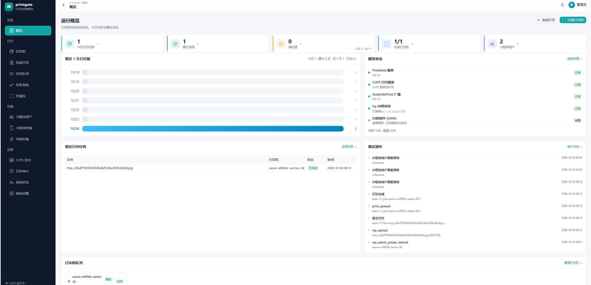
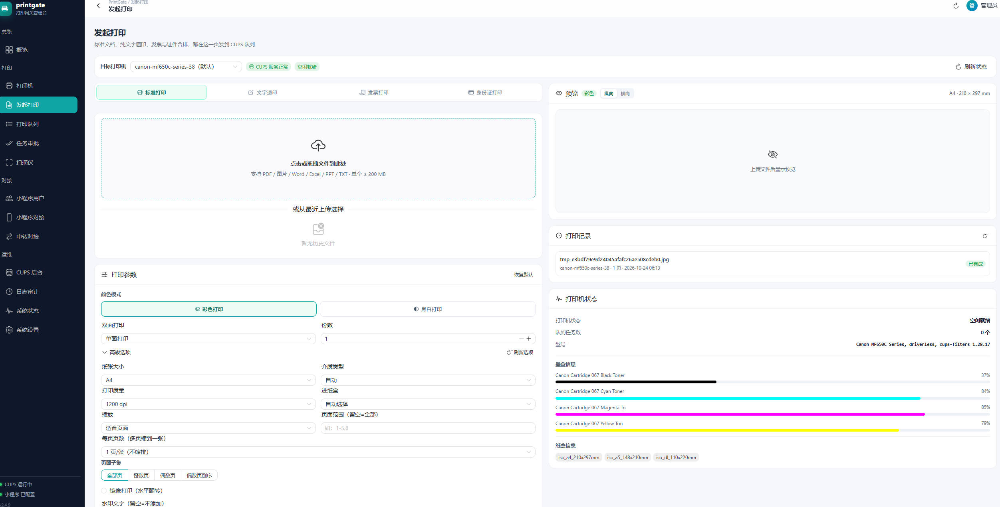
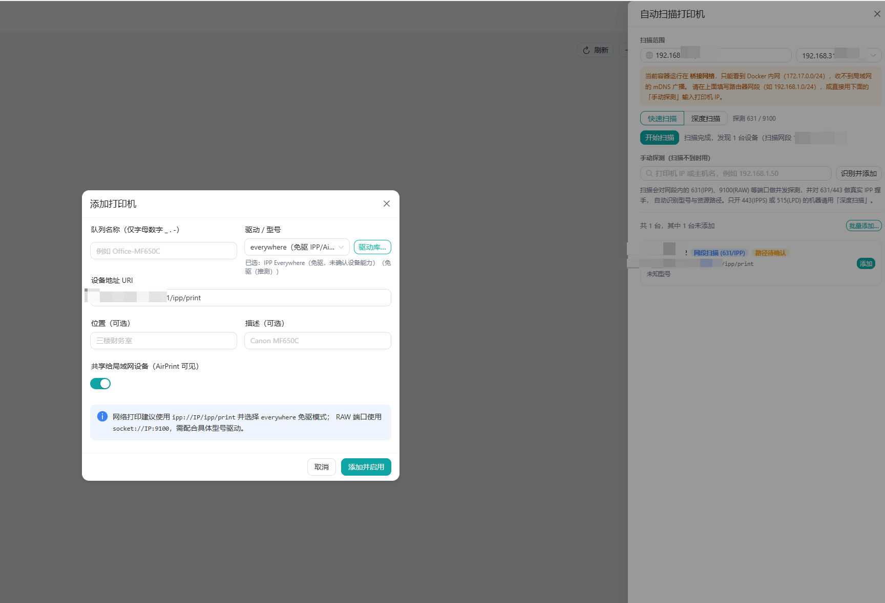
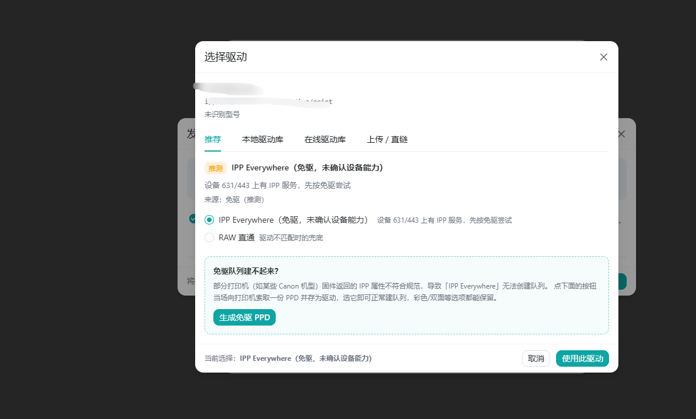
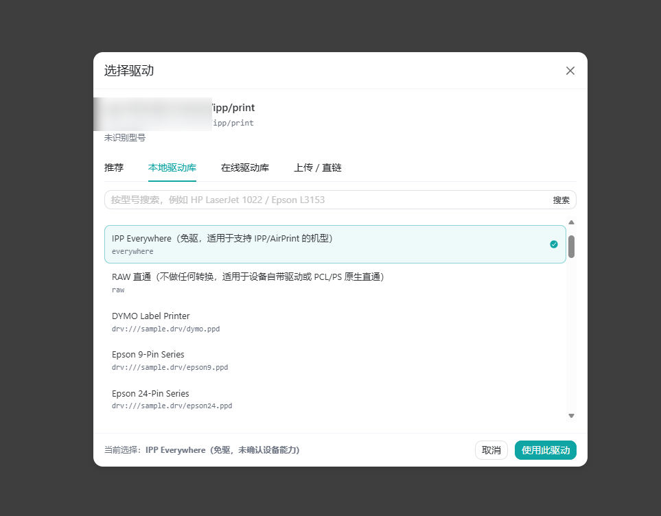
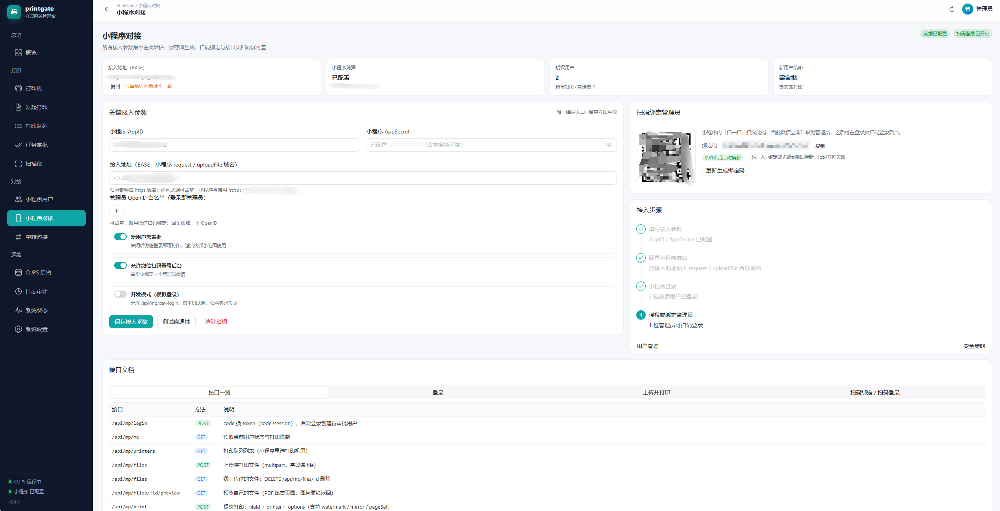
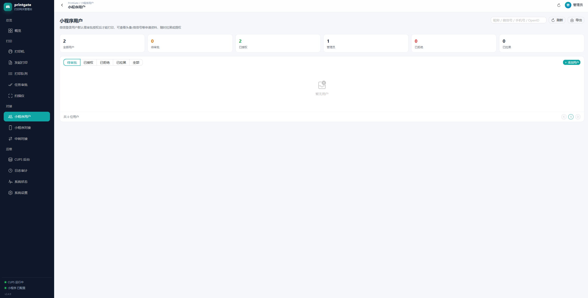
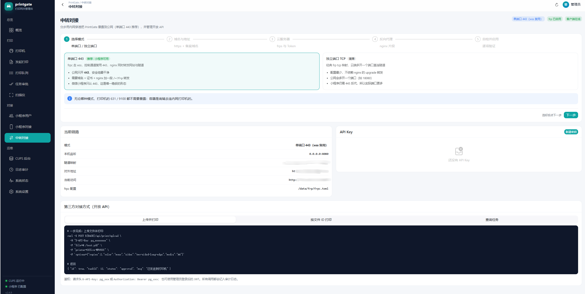
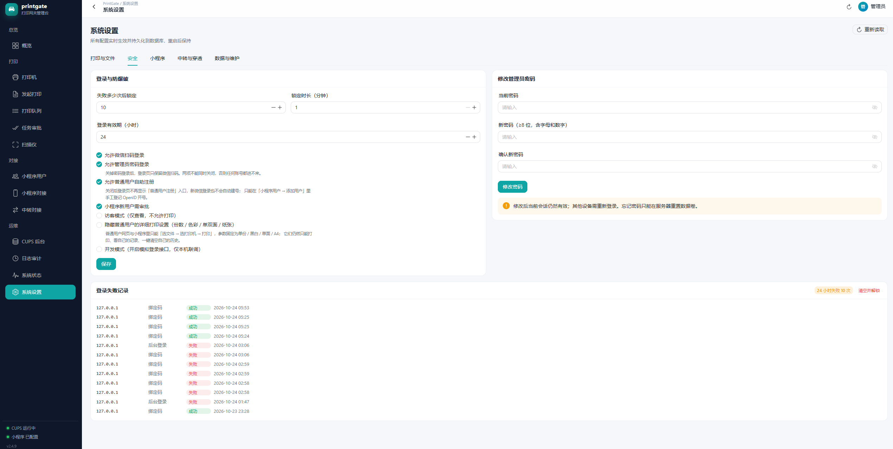

# PrintGate

[](https://hub.docker.com/repository/docker/tomdfwe/printgate/general)
[](https://hub.docker.com/repository/docker/tomdfwe/printgate/general)
[](https://hub.docker.com/repository/docker/tomdfwe/printgate/general)
[](LICENSE)

> CUPS 打印网关 + 微信小程序远程打印 + Vue3 管理台。
> 一个容器里同时跑 CUPS、Avahi 与 Web 服务，把内网打印机变成「扫码就能打」的云打印机。

镜像地址：**[hub.docker.com/repository/docker/tomdfwe/printgate](https://hub.docker.com/repository/docker/tomdfwe/printgate/general)**

```bash
docker pull tomdfwe/printgate
```



*运行概览：今日任务、累计完成、在线打印机与 7 日趋势，右侧服务健康清单逐项体检 CUPS、Avahi、frp 与扫描组件。*

---

## 1. 功能特性

- **打印入口**：标准打印（PDF/Office/图片）、文字速印、发票合排、身份证正反面合一张 A4，四种模式一页切换。
- **打印参数**：色彩模式（支持彩色/黑白分段）、份数、单双面、纸张、介质、质量、进纸盒、缩放、页面范围、
  每页页数、页面子集（全部/奇数/偶数/偶数倒序）、镜像、水印、自定义 CUPS 参数。
- **实时预览**：边改参数边渲染，附最近 5 条打印记录与打印机状态（队列数、型号、墨盒余量、纸盒）。
- **打印机发现**：mDNS/AirPrint 广播、CUPS 设备枚举、网段 IPP/RAW 并发探测三路并行，扫到即可添加。
- **驱动中心**：免驱优先（IPP Everywhere），失败回退 PCL/PostScript，另提供本地驱动库、OpenPrinting 在线库、PPD 上传与直链下载。
- **队列管理**：暂停/恢复、停止接收、设为默认、测试页、删除、查看驱动可选项。
- **任务审批**：逐单审批可开关，批量批准/拒绝/取消、失败重试。
- **用户体系**：管理员进管理台，普通用户进独立打印门户，只能看到自己的文件与记录。
- **微信能力**：小程序登录、扫码绑定管理员、网页扫码登录、用户审批/拉黑/提权。
- **扫描仪**：SANE 设备枚举，支持分辨率/色彩/来源/页数，扫描到 JPEG/PNG/PDF，附分级排障提示。
- **历史清理**：按任务记录 / CUPS 作业 / 虚拟打印机落盘 / 源文件四类统计占用，可手动分类清理或按天自动清理。
- **内网穿透**：内置 frp 客户端与五步向导，支持单端口 443 复用（小程序可用）与独立端口 TCP 两种模式。
- **审计与运维**：全量操作审计可导出 CSV、运行日志、登录失败记录与解锁、容器内 CUPS 运维面板、数据库备份。



*发起打印：左侧上传区与全部打印参数，右侧实时预览、打印记录与打印机状态（墨量、纸盒）。*

---

## 2. 快速开始

### 2.1 一条命令跑起来

```bash
docker pull tomdfwe/printgate

docker run -d --name printgate --restart unless-stopped \
  -p 8080:8080 -p 631:631 -e TZ=Asia/Shanghai \
  -v /opt/printgate/data:/data \
  -v /opt/printgate/cups:/etc/cups \
  tomdfwe/printgate
```

打开 `http://<主机IP>:8080`，首次进入初始化向导，设置管理员密码（≥8 位，含字母与数字）后自动登录。

> 镜像目前只发布 **linux/arm64**（树莓派、N1、ARM NAS 等）。x86 主机请从源码构建，见 [2.4](#24-从源码构建)。
> 拉取时报 `no matching manifest for linux/amd64` 就是这个原因。

### 2.2 Docker Compose 部署（推荐）

一条命令适合试水；长期使用建议用 Compose —— 卷、环境、健康检查都写在文件里，升级和迁移不会漏参数。

**第 1 步：建目录**

```bash
mkdir -p /opt/printgate && cd /opt/printgate
```

**第 2 步：写 `docker-compose.yml`**

```yaml
services:
  printgate:
    image: tomdfwe/printgate:latest
    container_name: printgate
    restart: unless-stopped
    ports:
      - "8080:8080"      # 管理台 + API（小程序也连这个端口）
      - "631:631"        # IPP / AirPrint
      # - "9100:9100"    # 虚拟打印机接收器，只在测试时对外
    environment:
      TZ: Asia/Shanghai
      # TRUST_PROXY: "true"   # 只有放在 Nginx/Caddy 反代后面时才打开
    volumes:
      - ./data:/data           # 数据库 / 上传件 / 扫描件 / 驱动 / frp 配置
      - ./cups:/etc/cups       # 打印队列与 PPD，必须持久化，否则重建容器丢队列
    healthcheck:
      test: ["CMD", "curl", "-fsS", "http://127.0.0.1:8080/api/health"]
      interval: 30s
      timeout: 5s
      retries: 3
      start_period: 25s
```

**第 3 步：启动**

```bash
docker compose up -d
docker compose ps                      # 状态与健康检查结果
docker compose logs -f printgate       # 首次启动看日志，等 cupsd 就绪
```

看到 `healthy` 后访问 `http://<主机IP>:8080` 完成初始化。

**常用操作**

| 目的 | 命令 |
| --- | --- |
| 启动 / 停止 | `docker compose up -d` / `docker compose down` |
| 改配置后重建 | `docker compose up -d`（yml 有变动会自动重建容器） |
| 升级到最新镜像 | `docker compose pull && docker compose up -d` |
| 看实时日志 | `docker compose logs -f printgate` |
| 进容器排查 | `docker compose exec printgate sh` |
| 备份数据 | `tar czf printgate-$(date +%F).tar.gz data cups` |

**几个容易踩的点**

- `./data` 与 `./cups` 首次启动会自动创建；容器以 root 运行，不需要额外改权限。
- 宿主机已装 CUPS 并占用 631 时，把映射改成 `"1631:631"`，或直接删掉这行（只走 8080 的 Web 端）。
- 要让 AirPrint 广播完整可用（iPhone 直接看到打印机），Linux 主机建议改成 `network_mode: host` 并删掉 `ports` 段；
  桥接网络下 mDNS 只在本容器网段内可见。此时「扫描范围」填真实局域网网段即可跨网段发现。
- USB 打印机 / 扫描仪需要把总线挂进容器，在 service 下加：

  ```yaml
    devices:
      - /dev/bus/usb:/dev/bus/usb
  ```

- 升级只用 `pull && up -d`，**不要 `down -v`** —— 那会连数据卷一起删。

### 2.3 环境变量

| 变量 | 默认 | 说明 |
| --- | --- | --- |
| `TZ` | `UTC` | 时区，建议 `Asia/Shanghai` |
| `PORT` | `8080` | Web 与 API 端口 |
| `PG_DATA_DIR` | `/data` | 数据目录（数据库、上传件、扫描件、驱动、frp 配置） |
| `MAX_FILE_MB` | `200` | 单文件上传上限 |
| `TRUST_PROXY` | 关 | 只在可信反代之后打开，否则可伪造 `X-Forwarded-For` 绕过锁定与限流 |
| `PG_ALLOW_PRIVATE_DRIVER_URL` | 关 | 允许从内网地址下载 PPD（默认拒绝，防 SSRF） |

> 打印相关默认值（份数、色彩、审批开关、限额等）首次启动后用管理台「系统设置」维护并写入数据库，
> 环境变量只作为首次初始化的兜底值。

### 2.4 从源码构建

```bash
git clone https://github.com/TomHaridi/PrintGate.git
cd PrintGate
docker compose up -d --build          # 仓库自带的 compose 用 build: . 构建
```

需要内置 LibreOffice（docx/xlsx/pptx → PDF，约 +90 MB）：

```bash
docker build --build-arg WITH_OFFICE=1 -t printgate:alpine .
```

x86 主机指定平台构建：

```bash
docker build --platform linux/amd64 -t printgate:alpine .
```

不装 Docker、直接在本机跑（需 Node 22+；打印功能依赖 CUPS，Windows 上只有界面与上传链路可用）：

```bash
cd server && npm install
cd ../web && npm install && npm run build    # 产物输出到 server/public
cd ../server && PG_DATA_DIR=../_data PORT=8080 node src/index.js
```

---

## 3. 首次配置

### 3.1 打印机与驱动

「打印机」→ 右上角 **自动扫描打印机**：填真实局域网网段 → 快速扫描（631/9100）或深度扫描（另加 443/515 并做 IPP 握手）。



*自动扫描：扫到的设备带识别结果与 URI 列出，可逐台添加或批量添加。*

扫描完成后会询问「是否自动安装驱动」，按以下顺序选：

1. 本地驱动库里型号匹配的 PPD；
2. IPP Everywhere 免驱（PWG Raster / URF）；
3. 按 `device-id` 的 PDL 选通用驱动（PCL 6 → `pxlmono`/`pxlcolor`，PCL 5 → HP LaserJet，PostScript → Generic PS）；
4. 兜底 RAW。

也可以手动添加：队列名（汉字/字母/数字/下划线/连字符）+ 设备地址 + 驱动。常见 URI：

```
ipp://192.168.1.50/ipp/print        ← 网络打印机首选，能回传墨量与纸盒
ipps://192.168.1.50:631/ipp/print   ← 打印机开了 TLS
socket://192.168.1.50:9100          ← 仅支持 RAW 的老机型
usb://Canon/MF650C                  ← USB 直连，需挂载 /dev/bus/usb
```



*推荐页签：设备有 IPP 服务时优先 IPP Everywhere 免驱；建不起队列时点「生成免驱 PPD」，现场取一份 PPD 当驱动用。*



*本地驱动库：`lpinfo -m` 全量列表 + 已导入的自定义 PPD，可按型号搜索，`everywhere` 与 `raw` 恒在最前。*

另外两个入口：**在线驱动库**直连 OpenPrinting 的 PPD 镜像检索导入；**上传 / 直链**支持
`.ppd` / `.ppd.gz` / `.tar.gz` / `.zip`（自动解包找 PPD），下载有大小、超时与跳转次数限制，默认拒绝内网地址。

### 3.2 小程序对接

「小程序对接」是接入参数的**唯一维护入口**（「系统设置」「中转对接」只做状态展示）：



*小程序对接：AppID / AppSecret / 接入地址 / 管理员白名单与三项策略集中一页，右栏是绑定二维码与接入进度，底部同屏接口文档。*

1. 填 AppID 与 AppSecret（保存后只显示掩码，留空表示不修改）；
2. 接入地址 BASE 填已备案的 https 域名；
3. 「测试连通性」返回「凭据有效」说明配置正确；
4. 让要当管理员的微信扫右侧二维码完成绑定，之后即可用网页「扫码登录」；
5. 小程序端 `POST /api/mp/login` 用 `wx.login` 的 code 换 token，新用户默认 `pending`。

### 3.3 用户审批



*小程序用户：按待审批 / 已授权 / 已拒绝 / 已拉黑分页签，可授权、拉黑、提权为管理员。*

被拉黑后该微信已发出的令牌立即失效，`whoami` 与扫码都返回 403，不会复活。

---

## 4. 打印链路

```
小程序 / 网页
   │  POST /api/mp/files 或 /api/files     上传落盘 /data/files，pdfinfo 校验页数
   ▼
PrintGate
   │  任务入库（tasks），按「审批每单」决定 pending / approved
   ▼
CUPS（容器内 cupsd）
   │  lp -d <队列> -n <份数> -o media/sides/print-color-mode/...
   ▼
打印机（ipp / ipps / socket / usb）
```

- 超过「单任务最大页数」直接拒收；失败原因写回任务记录，可在「任务审批」一键重试。
- 无实体打印机时，「打印机」页可创建**虚拟打印机**：容器内 `127.0.0.1:9100` 起接收器并建 `PrintGate-Virtual` 队列，
  结果落到数据卷 `spool/`，用来验证「上传 → 队列 → 提交 → 落盘」全链路。

---

## 5. 扫描仪

镜像内置 `sane` + `sane-utils`（`scanimage` / `sane-find-scanner`）+ `sane-network`，不用另装。要做的是把设备送进容器：

| 设备类型 | 需要做的事 |
| --- | --- |
| USB 扫描仪 | 启动参数加 `--device /dev/bus/usb`（compose 里放开 `devices` 段） |
| 网络一体机（eSCL/AirScan） | 与容器同网段即可发现；跨网段改用 `network_mode: host`；也可在 `/etc/sane.d/airscan.conf` 手写地址 |
| 老机型 | 容器内 `apk add sane-airscan`；USB 机型需对应后端（epson2、canon、genesys…） |

```bash
docker exec printgate scanimage --version   # 组件在不在
docker exec printgate sane-find-scanner     # USB 层看不看得到设备
docker exec printgate scanimage -L          # SANE 认到了哪些设备
```

管理台「扫描仪」页会区分三种情况给提示：未装组件 / 未挂 USB / 缺驱动，并直接给出对应命令。

---

## 6. 公网访问（中转对接）

家里或办公室一般没有公网 IP，用内置 frp 客户端把 8080 暴露出去。



*中转对接：五步向导（出网模式 → 公网地址 → 云服务器 frps → nginx 片段 → 自检），下方实时显示当前环境与 frpc 配置路径。*

| 模式 | 适用 | 说明 |
| --- | --- | --- |
| **单端口 443（推荐）** | 要跑小程序 | nginx 终结 TLS，frp 走 wss 复用 443，打印机 631/9100 全程不暴露 |
| 独立端口 TCP | 只给自己或网页用 | 简单，但要额外放行端口，小程序用不了 |

向导会生成三段配置：`frps.toml`（云服务器）、nginx 片段、`frpc.toml`（自动写入 `/data/frp/frpc.toml`）。三个要点：

1. **不要加** `transport.tls.force = true` —— TLS 由 nginx 终结，frps 收明文即可；
2. nginx 的 `client_max_body_size` 要调大，默认 1m 会把上传拦成 413；
3. 容器加 `TRUST_PROXY=true`，否则审计里全是内网地址、防爆破也会把所有人当成同一个 IP。

第 5 步自检会实跑：本机服务、打印机就绪、`frpc verify` 语法、客户端进程、服务端 7000 连通、BASE 是否 https、
公网回连 `/api/health`。全绿再启用。

同一页底部还有**开放 API**：请求头带 `Authorization: Bearer <API_KEY>` 即可上传并打印、查询任务，适合自建前端或脚本调用。

---

## 7. 安全设计



*系统设置：登录失败阈值与锁定时长、三种登录方式开关、在线改密，底部是登录失败记录与一键解锁。*

- **口令**：`scrypt(N=16384,r=8,p=1)` + 16 字节随机盐，首次向导设置，可在线改密。
- **防爆破**：登录失败按 IP 计数入库，达阈值锁定并返回剩余次数；绑定码、二维码轮询、扫码确认、API Key 各自独立限流。
- **绑定码**：32 位 hex（128 bit 随机）、定时安全比较、一码一人 + 默认 10 分钟 TTL，用后即换。
- **角色隔离**：管理员会话 `scope=admin`，普通用户 `scope=miniapp`；普通用户调管理接口一律 401/403。
- **登录方式互斥保护**：密码登录与扫码登录不能同时关闭，避免把自己锁在门外。
- **会话**：JWT HS256，密钥首次启动随机生成并持久化，默认 24 小时有效。
- **最小暴露面**：CUPS 自带 Web 界面关闭（`WebInterface No`），管理级 IPP 操作仅限本机，631 只放行局域网打印。
- **传输**：容器不内置 TLS，公网部署请在前置 Nginx/Caddy 上启用 HTTPS。
- **生成内容防注入**：`frpc.toml` 先做字符集白名单再按 TOML 转义；审计 CSV 中和 `= + - @` 公式前缀；JWT 校验显式锁定 `HS256`。

> 容器内 `cupsd` 需要 root 才能监听 631 并管理队列，因此进程以 root 启动；应用侧所有外部命令均通过
> `execFile` 参数数组调用、不经 shell，并对队列名、页码、参数做白名单校验。若要严格非 root，可把 CUPS 拆成独立容器。

---

## 8. 已知限制

- **镜像架构**：目前只发布 arm64；x86 需从源码构建。
- **Office 文档**：默认镜像不含 LibreOffice，需构建时加 `--build-arg WITH_OFFICE=1`（约 +90 MB）。
- **USB 设备**：打印机与扫描仪都需要 `--device /dev/bus/usb`。
- **AirPrint 广播**：桥接网络下 mDNS 跨网段不可达，Linux 主机建议 `network_mode: host`。
- **墨盒/纸盒**：依赖打印机通过 IPP 上报 `marker-levels` / `media-ready`，虚拟打印机与部分老机型不上报，界面显示「未上报」。
- **扫码登录**：二维码内容为 `printgate://login?ticket=...`，自研小程序需自行解析该协议。

---

## 9. 目录结构

```
PrintGate/
├─ Dockerfile                 多阶段构建：web 构建 / 后端依赖 / Alpine 运行时
├─ docker-compose.yml         源码构建用（build: .）
├─ docker/
│  ├─ entrypoint.sh           CUPS + Avahi + PrintGate + frp 守护
│  └─ cupsd.conf              A4/AirPrint 修复、最小暴露面
├─ screenshots/               README 截图
├─ server/                    Node.js 服务（Express + better-sqlite3）
│  ├─ src/
│  │  ├─ index.js  config.js  db.js  security.js  middleware.js
│  │  ├─ cups.js  cupsadmin.js  ipp.js  ipp-proxy.js  printerstore.js
│  │  ├─ discover.js  drivers.js  scan.js  system.js  cleanup.js
│  │  ├─ pdf.js  render.js  converter.js  idcard.js  fsutil.js
│  │  ├─ wechat.js  orphans.js
│  │  └─ routes/   auth account mp print printers users settings
│  │               system cups drivers relay wechat apikeys
│  └─ public/                 前端构建产物（vite 输出）
├─ tools/                     运维与自检脚本
└─ web/                       Vue3 + NaiveUI + Vite
   └─ src/  views/  layouts/  components/  api.js  router.js  store.js
```

---

## 10. 常见问题

| 现象 | 排查 |
| --- | --- |
| `no matching manifest for linux/amd64` | 镜像只有 arm64，x86 请从源码构建 |
| `docker compose up` 后 8080 打不开 | `docker compose logs printgate` 看 cupsd 是否起来；确认端口未被占用 |
| 631 端口冲突 | 宿主机已装 CUPS，把映射改成 `1631:631` 或删掉该行 |
| 打印机列表为空 | 桥接网络收不到 mDNS，在「扫描范围」填真实网段，或用「手动探测」输 IP |
| 添加队列成功但打印 404 | 资源路径不对，把 URI 里的 `/ipp/print` 换成 `/ipp/printer` 或 `/` |
| 打印空白或乱码 | 驱动不匹配；RAW 队列只适用于打印机原生支持该格式的情况 |
| `everywhere` 建队列失败 | 打印机 IPP 属性不合规范，点「生成免驱 PPD」 |
| 小程序登录报 AppSecret 无效 | 「小程序对接 → 测试连通性」，确认 AppID 与 Secret 属于同一个小程序 |
| 上传大文件 413 | nginx `client_max_body_size` 太小 |
| 审计里 IP 全是内网地址 | 反代后面没加 `TRUST_PROXY=true` |
| 忘记管理员密码 | 删掉数据卷里的 `data/printgate.db` 重新初始化（会丢配置与任务记录） |

---

## 11. 技术栈与许可证

**后端**：Node.js 22 · Express 4 · better-sqlite3（WAL）· pdfkit · sharp · qrcode · jsonwebtoken · multer

**打印与扫描**：CUPS（IPP 2.0 直连 + `lpadmin` / `lpstat` 命令双通道）· SANE（`sane` / `sane-utils` / `sane-network`）

**前端**：Vue 3.5 · Vite 6 · Naive UI 2.40 · Vue Router 4（hash 模式）· axios

**容器**：多阶段构建，Node 22 Alpine 运行时内置 CUPS、Avahi、sane 与中文字体，Office 转换可选 LibreOffice

本项目以 [MIT](LICENSE) 发布。运行时引用的第三方组件及其许可证：

| 组件 | 许可证 | 引用方式 |
| --- | --- | --- |
| **CUPS** | GPL-2.0 / Apache-2.0 双许可 | 独立进程调用（`cupsd`、`lpadmin`、`lpstat`）并通过 IPP 协议通信，不与本项目代码静态链接 |
| LibreOffice | MPL-2.0 | 可选组件（`WITH_OFFICE=1`），独立进程调用 `soffice` |
| SANE | GPL-2.0+ | 独立进程调用 `scanimage` / `sane-find-scanner` |
| Avahi | LGPL-2.1 | 独立进程，提供 mDNS / AirPrint 广播 |
| frp | Apache-2.0 | 独立二进制，客户端由入口脚本守护 |

> CUPS 为 GPL-2.0 / Apache-2.0 双许可，本项目按其 Apache-2.0 分支以独立进程方式调用，源码在 MIT 下分发；
> 若修改并分发 CUPS 自身，仍需遵循其许可证。
